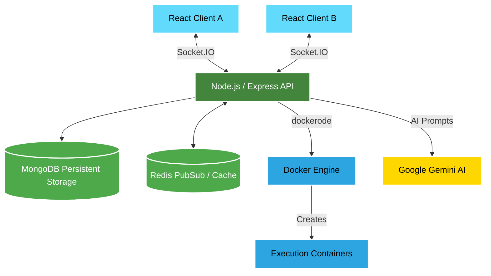
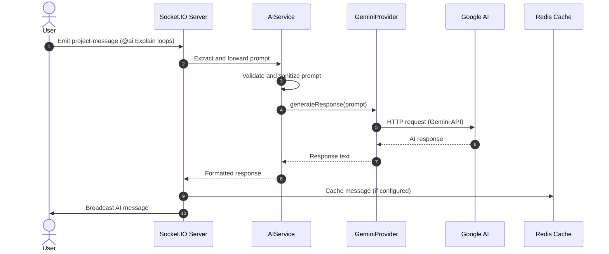
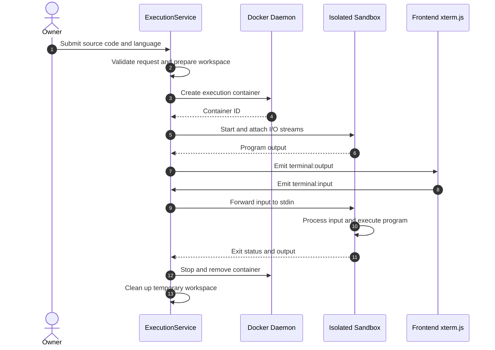

# 🚀 CodeCrew

<div align="center">

### A Real-Time Collaborative Coding and Chatting Platform

Collaborate, code, execute programs, and learn together in a shared development workspace — powered by React, Socket.IO, Docker, Redis, and Google Gemini AI.

<br />


</div>

---

## 📌 Overview

**CodeCrew** transforms remote development by simulating an in-person pair-programming environment. Multiple developers can join a shared workspace to write, execute, and discuss code in real time.

The platform integrates an **AI Programming Mentor** powered by Google Gemini, which participates in collaborative chat to guide developers, explain code, and assist with programming problems.

From synchronized collaboration and interactive code execution to AI-assisted learning, CodeCrew brings essential development tools together in one workspace.

---

## ✨ Key Features

### ⚡ 1. Real-Time Collaboration

- Instant messaging and synchronized room states powered by **Socket.IO** and **Redis**.
- Multiple developers can collaborate in a shared workspace.
- Real-time updates help participants stay synchronized during coding sessions.

### 🐳 2. Interactive Code Execution

- Compile and execute programs on the backend using isolated **Docker containers**.
- Supports languages such as C++, Python, Java, and JavaScript, depending on the configured execution environment.
- Interactive standard input and output are streamed to a web-based terminal.
- Execution containers and temporary workspaces can be cleaned up after execution.

### 🤖 3. AI Programming Mentor

- Integrated with **Google Gemini AI**.
- Mention `@ai` in the chat to request programming assistance.
- Provides Markdown-formatted explanations, code walkthroughs, and time and space complexity analysis.
- Uses a dedicated AI service layer to validate requests and communicate with the configured AI provider.

### 🔐 4. Role-Based Access Control

- Room ownership determines who can manage a coding session.
- Room creators can manage collaborators, invite participants, and remove members where supported.
- Access controls help maintain an organized collaborative environment.

### 💻 5. Robust Code Editor

- Powered by **Monaco Editor**, the editor engine used by Visual Studio Code.
- Syntax highlighting and familiar code-editing functionality.
- Supports a customizable dark-themed coding workspace.

### 🚄 6. Performance and State Management

- Redis supports fast, shared application state and messaging workflows.
- Docker execution environments isolate individual program runs.
- WebSocket communication enables real-time collaboration between connected clients.

---

## 🏗️ System Architecture

CodeCrew uses a modular, microservice-inspired architecture. The React frontend communicates with the Node.js backend through APIs and WebSockets, while the backend integrates persistence, shared state, AI services, and isolated execution environments.



### Architecture Components

| Component | Responsibility |
|---|---|
| React | User interface, coding workspace, chat, and terminal |
| Node.js / Express | API endpoints and backend application logic |
| Socket.IO | Real-time communication between connected users |
| MongoDB | Persistent storage for configured application data |
| Redis | Shared state, caching, and messaging where implemented |
| Docker | Isolated environments for compiling and running code |
| Google Gemini | AI-powered programming assistance |
| Monaco Editor | Browser-based code editing experience |

---

## 🔄 Sequence Diagrams

### 1. AI Mentorship Workflow

The AI mentorship workflow starts when a user mentions `@ai` in the collaborative chat. The backend processes the request, calls the AI provider, and returns the response to the connected workspace.



**Workflow summary:**

1. A user submits a message containing `@ai`.
2. The backend identifies the AI request and extracts the prompt.
3. The AI service validates the request.
4. The provider communicates with Google Gemini.
5. The response is returned and formatted for the application.
6. The AI message is broadcast to the workspace, with caching depending on the configured implementation.

### 2. Interactive Docker Execution Workflow

The code execution workflow manages temporary source files, creates an isolated execution environment, and streams program output to the frontend terminal.



**Workflow summary:**

1. The user submits code and a selected programming language.
2. The backend validates the request and prepares a temporary workspace.
3. Docker creates an execution container using the configured language image.
4. The execution service attaches input and output streams.
5. Output is forwarded to the frontend terminal, and supported interactive input is sent to the running process.
6. After execution, the service cleans up the container and temporary files according to its lifecycle logic.

---

## 📂 Project Folder Structure

The application separates frontend components from backend controllers, services, and infrastructure integrations.

```text
CodeCrew/
├── frontend/                         # React single-page application (Vite)
│   ├── src/
│   │   ├── components/               # Reusable UI components
│   │   ├── config/                   # Axios and Socket.IO configuration
│   │   ├── context/                  # Shared application state and auth
│   │   ├── Pages/                    # Application pages and views
│   │   │   └── Room.jsx              # Collaborative room functionality
│   │   └── index.css                 # Global styles and Markdown overrides
│   └── package.json
│
├── backend/                          # Node.js API and WebSocket server
│   ├── Controllers/                  # Request handling and HTTP responses
│   ├── Middleware/                   # Authentication and validation
│   ├── models/                       # Mongoose database schemas
│   ├── Services/                     # Application business logic
│   │   ├── Execution/                # Code execution management
│   │   │   ├── LanguageManager.js    # Language mappings and compile commands
│   │   │   └── TerminalManager.js    # Terminal input/output routing
│   │   ├── AIService.js              # AI request validation and orchestration
│   │   ├── GeminiProvider.js         # Google Gemini integration
│   │   └── RoomService.js            # Room state and membership logic
│   ├── server.js                     # HTTP and WebSocket entry point
│   └── .env                          # Local environment variables (not committed)
│
└── README.md                         # Project documentation
```

*Note: This tree reflects the documented architecture. Individual filenames and folders should be verified against the current repository.*

---

## 🧠 Design Decisions

### Why Redis for Chat and Shared State?

Repeatedly writing transient chat or collaboration state to a persistent database can add unnecessary latency and storage overhead.

Redis provides in-memory data structures, caching, and Pub/Sub capabilities that can support fast message delivery and shared state across backend instances. MongoDB remains available for data that needs persistent storage.

The exact division between Redis and MongoDB depends on the application's implemented data flow.

### Why Dockerode for Code Execution?

Running arbitrary user-submitted programs directly on the host creates significant security risks.

Dockerode provides a Node.js interface to the Docker Engine, allowing the backend to create, start, manage, and remove execution containers programmatically.

Containers should be configured with appropriate resource limits, restricted privileges, network controls, and filesystem protections. Docker containers alone are not a complete security boundary for hostile code.

### Why Use an AI Provider Pattern?

Separating AI orchestration from provider-specific integration makes the application easier to maintain.

- **AIService:** Validates and orchestrates AI requests.
- **GeminiProvider:** Handles communication with Google Gemini.
- **Backend server:** Routes requests and coordinates application services.

This separation can make it easier to add another provider in the future without coupling all application logic to a single SDK.

---

## 🔒 Security Considerations

### Container Isolation

Execute submitted programs inside appropriately configured containers. Use non-root users, resource quotas, restricted capabilities, and network isolation wherever possible.

### Ephemeral Workspaces

Temporary source files and execution artifacts should be removed after execution, including during error handling and timeouts.

### Environment Variables

Sensitive configuration, including database connection strings, Gemini API keys, and JWT secrets, should be stored in environment variables and excluded from version control.

Never commit real credentials. Provide an `.env.example` file containing placeholder values instead.

### JWT Authentication

Protect authenticated API routes and WebSocket handshakes using appropriately validated JSON Web Tokens. Validate token signatures, expiration, and authorization rules on the server.

### Additional Execution Safeguards

- Apply execution timeouts and memory/CPU limits.
- Validate supported programming languages and input payloads.
- Avoid exposing Docker daemon access to untrusted clients.
- Restrict container privileges and outbound network access as required.
- Sanitize user-controlled inputs and handle process termination safely.

---

## 🚀 Getting Started

Follow these steps to run the application locally.

### Prerequisites

Install and configure the following tools and services:

- **Node.js:** Version 18 or later, subject to the dependencies in your project.
- **npm:** Package manager included with Node.js.
- **Docker Engine:** Running locally for code execution.
- **MongoDB:** A local instance or MongoDB Atlas cluster, if required by the application.
- **Redis:** A local instance or hosted Redis service, if required by the application.
- **Google Gemini API key:** Required for AI mentorship.

### 1. Clone the Repository

```bash
git clone https://github.com/Kunal-Bagul/CodeCrew.git
cd CodeCrew
```

### 2. Configure the Backend

```bash
cd backend
npm install
```

Create a local environment file from the example template, if it exists.

**Windows PowerShell:**

```powershell
Copy-Item .env.example .env
```

**Linux / macOS:**

```bash
cp .env.example .env
```

Add the required configuration values to `backend/.env`. Typical settings may include:

```dotenv
PORT=5000
MONGODB_URI=your_mongodb_connection_string
REDIS_URL=your_redis_connection_string
GEMINI_API_KEY=your_gemini_api_key
JWT_SECRET=your_jwt_secret
```

*These variable names are illustrative. Use the exact names expected by your backend configuration, and do not commit real secrets.*

Start the backend using the script defined in `backend/package.json`. For example, if the project defines a `dev` script:

```bash
npm run dev
```

### 3. Configure the Frontend

Open a second terminal at the project root and run:

```bash
cd frontend
npm install
npm run dev
```

Open the local URL printed by the Vite development server.

### 4. Verify the Dependencies

Before testing the full application, verify that:

- The backend starts successfully.
- MongoDB and Redis connections work where configured.
- Docker is running and the backend can access the Docker Engine.
- The Gemini API key is valid and AI requests succeed.
- The frontend can communicate with the backend.
- WebSocket connections and code execution work as expected.

*Note: The exact scripts, environment variable names, ports, and dependency requirements must match the current implementation.*

---

## 📈 Performance Highlights

CodeCrew is designed around responsive collaboration, efficient code editing, and isolated program execution.

### Real-Time Communication

Socket.IO supports low-latency messaging and synchronized workspace updates. Actual latency depends on network conditions, server load, and deployment configuration.

### Efficient Execution Environments

Pre-pulled language images can reduce the overhead of downloading dependencies for each run. Container startup and compilation time vary according to the language, image, hardware, and source program.

### Markdown Rendering

Markdown rendering enables structured AI responses with code blocks and formatted explanations. Efficient rendering and component updates can help maintain a smooth user experience.

### WebSocket Reconnection

Reconnection handling can help clients recover after temporary network interruptions. Restoring missed messages or room state requires appropriate server-side synchronization and recovery logic.

---

## 🗺️ Future Roadmap

- [x] LeetCode-style environment for competitive programming.
- [ ] Expand collaborative coding and room-management capabilities.
- [ ] Improve execution observability and error reporting.
- [ ] Enhance AI mentorship and programming explanations.
- [ ] Strengthen automated testing and deployment workflows.

*Roadmap items should be updated as features are completed or priorities change.*

---

## 🤝 Contributing

Contributions, bug reports, and feature suggestions are welcome.

1. Fork the repository.
2. Create a feature branch.
3. Implement and test your changes.
4. Submit a pull request describing the change.

Please avoid committing secrets, credentials, or generated files.

---

## 👨‍💻 Author

**Kunal Bagul**

[GitHub Profile](https://github.com/Kunal-Bagul)

---

<div align="center">

**Built to make collaborative programming more interactive, accessible, and productive.**

⭐ If you find CodeCrew useful, consider starring the repository!

</div>